<picture>
  <source media="(prefers-color-scheme: dark)" srcset="assets/banner-dark.svg">
  <source media="(prefers-color-scheme: light)" srcset="assets/banner-light.svg">
  
</picture>

[English](README.md) | Bahasa Indonesia

### Tentang

Software engineer dan data engineer dengan spesialisasi pengembangan platform web siap produksi, integrasi kecerdasan buatan, dan keandalan sistem. Terbiasa merancang aplikasi web end-to-end, mengorkestrasi agen LLM untuk otomatisasi alur kerja, serta membangun pipeline data dan pengujian otomatis.

Rekam jejak mencakup pembangunan sistem informasi rumah sakit, deployment SaaS multi-tenant, publikasi riset keamanan kode LLM pada jurnal ilmiah terakreditasi, serta pengelolaan dataset terbuka dan pemodelan prediktif di Kaggle.

<picture>
  <source media="(prefers-color-scheme: dark)" srcset="assets/stats-id-dark.svg">
  <source media="(prefers-color-scheme: light)" srcset="assets/stats-id-light.svg">
  
</picture>

### Proyek Unggulan

<table>
  <tr>
    <td width="50%" valign="top">
      
       
      <b><a href="https://github.com/MasterPandaa/QR-Camera">QR-Camera</a></b> &bull; <i>Injektor MediaStream Browser untuk QA</i>
      
Ekstensi browser Manifest V3 yang mengintersepsi stream getUserMedia untuk menginjeksi video barcode dan QR code virtual langsung ke input webcam. Menghilangkan kebutuhan pemindaian kamera fisik dalam otomatisasi pengujian perangkat lunak.

      <code>JavaScript</code> <code>WebRTC</code> <code>Manifest V3</code> <code>Chrome / Firefox</code>
    </td>
    <td width="50%" valign="top">
      
       
      <b><a href="https://github.com/MasterPandaa/CineGraph-AI">CineGraph-AI</a></b> &bull; <i>Sistem Rekomendasi Graph Neural Network</i>
      
Mesin rekomendasi film berbasis embedding node topologis GraphSAGE dan pencarian similarity cosine. Menggantikan pemfilteran heuristik dangkal dengan representasi graf relasional bernilai tinggi.

      <code>PyTorch Geometric</code> <code>GraphSAGE</code> <code>Streamlit</code> <code>Scikit-Learn</code>
    </td>
  </tr>
  <tr>
    <td width="50%" valign="top">
      
       
      <b><a href="assets/banners/ASSRI.svg">ASSRI</a></b> &bull; <i>Simulator Telekonsultasi &amp; Agen Triase AI</i>
      
Simulator telekonsultasi klinis berbasis Laravel yang mengorkestrasi agen multi-agent otonom n8n menggunakan model Gemini, OpenAI, dan Llama untuk skrining awal kondisi pasien dan penjadwalan triase otomatis.

      <code>Laravel 11</code> <code>n8n Workflows</code> <code>Gemini API</code> <code>OpenAI</code>
    </td>
    <td width="50%" valign="top">
      
       
      <b><a href="https://github.com/MasterPandaa/Prompt-Engineering-Collection">Prompt-Engineering-Collection</a></b> &bull; <i>Benchmark Keamanan SAST pada Kode LLM</i>
      
Dataset empiris dan benchmark evaluasi kualitas keamanan kode hasil generasi LLM menggunakan alat analisis statis pada 218 eksperimen prompting. Terpublikasi di Jurnal SISTEMASI, terakreditasi Sinta 3.

      <code>Python</code> <code>SAST</code> <code>Semgrep</code> <code>Bandit</code> <code>Sinta 3</code>
    </td>
  </tr>
  <tr>
    <td width="50%" valign="top">
      
       
      <b><a href="https://github.com/MasterPandaa/Healtisin">Healtisin</a></b> &bull; <i>Platform Konsultasi Medis Bertenaga AI</i>
      
Platform telekonsultasi kesehatan berbasis Laravel 11 dengan chatbot triase gejala berbasis AI, pencarian basis pengetahuan medis terstruktur, dan integrasi pembayaran otomatis Midtrans. Semi-finalis internasional PROXOCORIS.

      <code>Laravel 11</code> <code>Triase NLP</code> <code>Midtrans</code> <code>MySQL</code>
    </td>
    <td width="50%" valign="top">
      
       
      <b><a href="https://github.com/MasterPandaa/SPMB">SPMB SaaS</a></b> &bull; <i>Portal Penerimaan Siswa Multi-Tenant</i>
      
Platform SaaS pendaftaran siswa baru berbasis cloud yang dirancang dengan Laravel, isolasi data multi-tenant, alur kerja verifikasi berkas, dan generator laporan tabular PDF serta Excel otomatis.

      <code>Laravel 11</code> <code>Multi-Tenant</code> <code>DOMPDF</code> <code>Ekspor Excel</code>
    </td>
  </tr>
</table>

### Fokus Rekayasa &amp; Kapabilitas Inti

| Bidang | Ruang Lingkup Rekayasa | Teknologi Utama |
| :--- | :--- | :--- |
| **Agen AI &amp; Otomatisasi Alur Kerja** | Orkestrasi otonom n8n, pipeline REST dan webhook multi-langkah, rekayasa prompt ber-guardrail, agen triase medis | `n8n` `Gemini API` `OpenAI` `Llama` |
| **Kualitas Perangkat Lunak &amp; QA** | Audit celah keamanan SAST, otomasi pengujian browser, rangkaian regresi black-box, siklus pengujian XP | `Playwright` `Semgrep` `Bandit` `PyTest` |
| **Full-Stack &amp; Aplikasi Web** | Arsitektur web siap produksi, modular monolith, backend SaaS multi-tenant, aplikasi seluler lintas platform | `Laravel 11` `React 19` `Next.js 16` `TypeScript` `Flutter` |
| **Data Engineering &amp; ML** | MapReduce terdistribusi di Cloudera HDFS, Graph Neural Networks, analisis sentimen NLP, engine web scraping | `Apache Hadoop` `PyTorch Geometric` `Scikit-Learn` `Spark` |
| **Infrastruktur &amp; Desain** | Pemodelan data relasional, otorisasi berbasis peran, deployment berbasis kontainer, desain komponen UI | `PostgreSQL` `MySQL` `Docker` `Tailwind CSS` `Figma` |

### Pengalaman Rekayasa Produksi

| Linimasa | Posisi &amp; Institusi | Sorotan Pekerjaan |
| :--- | :--- | :--- |
| Mar 2025 sampai Jan 2026 | **Full-Stack Developer Intern**, PT Global Data Inspirasi | Merancang ASSRI, simulator telekonsultasi klinis berbasis Laravel dengan integrasi alur kerja multi-agent n8n menggunakan Gemini, OpenAI, dan Llama untuk skrining awal pasien dan reservasi dokter spesialis. |
| Jul sampai Agu 2025 | **Freelance Full-Stack Developer**, SDIT Luqman Al Hakim | Mengembangkan portal web sekolah dan CMS mandiri berisi 15 modul admin, diverifikasi melalui siklus pengujian Extreme Programming. |
| Mei sampai Jun 2025 | **Freelance Full-Stack Developer**, Life Media | Membangun SaaS penerimaan murid baru multi-tenant berbasis Laravel dengan modul verifikasi berkas dan generator laporan tabular volume tinggi. |
| Okt 2024 sampai Jan 2025 | **Full-Stack Developer Intern**, RS AMC Muhammadiyah | Membangun tiga sistem web rumah sakit untuk rekam MCU, approval cuti kerja karyawan dengan kelulusan uji black-box 100%, presensi wajah berbasis GPS, serta aplikasi seluler SatuAMC berbasis Flutter. |

### Benchmark Machine Learning &amp; Dataset Terbuka

| Sasaran Model | Arsitektur Machine Learning | Hasil Evaluasi |
| :--- | :--- | :--- |
| Deteksi transaksi fraud | Regularized Logistic Regression | Akurasi 94%, precision 0.89, recall 0.82 |
| Sentimen ulasan pelanggan Gojek | Ekstraksi fitur TF-IDF dengan Random Forest | Akurasi 86%, skor F1 0.84 |
| Sentimen ulasan aplikasi Spotify | Bidirectional LSTM dengan learned embedding | Akurasi 89%, skor F1 0.87 |
| Rekomendasi graf film | GraphSAGE via PyTorch Geometric | Recall@10 0.31, NDCG@10 0.28 |
| Regresi estimasi harga Tokopedia | Ridge Regression dengan NLP judul produk | R² 0.78, RMSE 42.3 |
| Klasifikasi risiko preeklamsia | Random Forest multiclass classification | Akurasi 91%, recall 0.88 |

Saya mempublikasikan pipeline ekstraksi data dan dataset terbuka di [Kaggle](https://www.kaggle.com/pandaa12) yang mencakup 50.000 produk Tokopedia, 18.000 rekaman sentimen YouTube banjir Sumatra 2025, 12 koleksi ulasan Google Play, data perhotelan Yogyakarta dari Traveloka, dan metadata film TMDB. Pipeline scraping dibangun menggunakan Playwright, google-play-scraper, dan TMDB API.

### Riset Akademis &amp; Rekognisi

- **2026**: Publikasi riset empiris evaluasi keamanan kode hasil generasi LLM menggunakan alat SAST pada berbagai strategi prompt engineering di Jurnal SISTEMASI, Volume 15 Nomor 5, terakreditasi Sinta 3, DOI 10.32520/stmsi.v15i5.6395.
- **2025**: Meraih predikat semi-finalis internasional kompetisi PROXOCORIS melalui pengembangan asisten triase medis Healtisin.
- **2025**: Pelaksanaan program pengabdian masyarakat literasi digital melalui skema PKM Pra Ngadisuryan dan KKN Dabag 2.
- **2024**: Publikasi artikel ilmiah peer-reviewed sistem informasi perizinan cuti kerja karyawan untuk Rumah Sakit Asri Medical Center.
- **2024**: Penerima predikat Mahasiswa Berprestasi tingkat universitas, sertifikasi kompetensi rekayasa perangkat lunak BNSP, dan pencatatan Hak Cipta HKI di Kemenkumham RI.

### Katalog Repositori

Tinjau direktori lengkap 26 repositori dengan banner visual terdedikasi dan metadata terstandarisasi di [METADATA_MANIFEST.md](METADATA_MANIFEST.md) atau buka [Katalog Showcase](assets/banners/index.html).

<a href="mailto:luthfiabd.14@gmail.com">
<picture>
  <source media="(prefers-color-scheme: dark)" srcset="assets/cta-id-dark.svg">
  <source media="(prefers-color-scheme: light)" srcset="assets/cta-id-light.svg">
  
</picture>
</a>

[Portofolio](https://portofolio-luthfi.up.railway.app) | [LinkedIn](https://www.linkedin.com/in/luthfiabdl/) | [Kaggle](https://www.kaggle.com/pandaa12) | [Email](mailto:luthfiabd.14@gmail.com) | [WhatsApp](https://wa.me/62895640311157) | [Instagram](https://instagram.com/luthfiabdl_)
