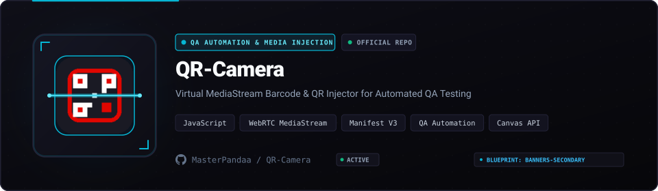
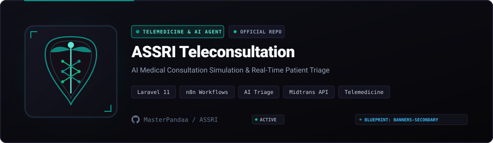
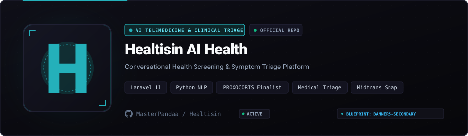
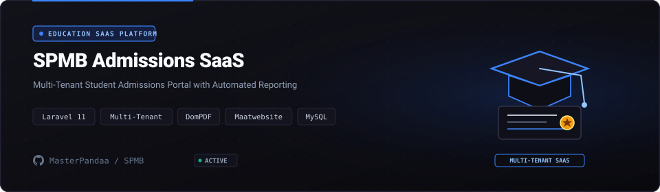

<picture>
  <source media="(prefers-color-scheme: dark)" srcset="assets/banner-dark.svg">
  <source media="(prefers-color-scheme: light)" srcset="assets/banner-light.svg">
  
</picture>

English | [Bahasa Indonesia](README.id.md)

### About

Full-stack and data engineer focused on building production software that connects AI capabilities with reliable infrastructure. Experienced in developing end-to-end web platforms, orchestrating LLM agents for enterprise workflows, and engineering automated testing and data pipelines.

My track record includes developing clinical information systems for hospitals, deploying multi-tenant SaaS products, researching LLM code security with peer-reviewed publications, and publishing open datasets and predictive models on Kaggle.

<picture>
  <source media="(prefers-color-scheme: dark)" srcset="assets/stats-en-dark.svg">
  <source media="(prefers-color-scheme: light)" srcset="assets/stats-en-light.svg">
  
</picture>

### Flagship Projects

<table>
  <tr>
    <td width="50%" valign="top">
      
       
      <b><a href="https://github.com/MasterPandaa/QR-Camera">QR-Camera</a></b> &bull; <i>Browser MediaStream QA Injector</i>
      
Manifest V3 browser extension intercepting getUserMedia streams to inject virtual QR codes and barcodes directly into webcam inputs. Eliminates physical camera scanning during automated web application testing.

      <code>JavaScript</code> <code>WebRTC</code> <code>Manifest V3</code> <code>Chrome / Firefox</code>
    </td>
    <td width="50%" valign="top">
      
       
      <b><a href="https://github.com/MasterPandaa/CineGraph-AI">CineGraph-AI</a></b> &bull; <i>Graph Neural Network Recommender</i>
      
Movie recommendation engine utilizing GraphSAGE topological node embeddings and cosine vector similarity search. Replaces shallow collaborative filters with graph representation learning.

      <code>PyTorch Geometric</code> <code>GraphSAGE</code> <code>Streamlit</code> <code>Scikit-Learn</code>
    </td>
  </tr>
  <tr>
    <td width="50%" valign="top">
      
       
      <b><a href="assets/banners/ASSRI.svg">ASSRI</a></b> &bull; <i>Medical Teleconsultation &amp; AI Triage</i>
      
Clinical teleconsultation simulator built with Laravel, coordinating n8n autonomous multi-agent workflows using Gemini, OpenAI, and Llama for pre-consultation patient intake and automated triage scheduling.

      <code>Laravel 11</code> <code>n8n Workflows</code> <code>Gemini API</code> <code>OpenAI</code>
    </td>
    <td width="50%" valign="top">
      
       
      <b><a href="https://github.com/MasterPandaa/Prompt-Engineering-Collection">Prompt-Engineering-Collection</a></b> &bull; <i>SAST LLM Security Benchmarks</i>
      
Empirical security dataset and benchmark suite evaluating LLM code generation quality with static analysis tools across 218 prompting experiments. Published in Jurnal SISTEMASI, Sinta 3.

      <code>Python</code> <code>SAST</code> <code>Semgrep</code> <code>Bandit</code> <code>Sinta 3</code>
    </td>
  </tr>
  <tr>
    <td width="50%" valign="top">
      
       
      <b><a href="https://github.com/MasterPandaa/Healtisin">Healtisin</a></b> &bull; <i>AI Clinical Consultation Platform</i>
      
Healthcare teleconsultation platform built with Laravel 11 featuring conversational AI symptom triage, custom medical knowledge base search, and automated Midtrans payment checkout. PROXOCORIS International Semi-Finalist.

      <code>Laravel 11</code> <code>NLP Triage</code> <code>Midtrans</code> <code>MySQL</code>
    </td>
    <td width="50%" valign="top">
      
       
      <b><a href="https://github.com/MasterPandaa/SPMB">SPMB SaaS</a></b> &bull; <i>Multi-Tenant Admissions Portal</i>
      
Cloud-ready student admissions SaaS platform engineered in Laravel with multi-tenant data isolation, document verification workflows, and automated high-throughput PDF and Excel report generation.

      <code>Laravel 11</code> <code>Multi-Tenant</code> <code>DOMPDF</code> <code>Excel Export</code>
    </td>
  </tr>
</table>

### Core Systems &amp; Engineering Focus

| Domain | Engineering Scope | Primary Technologies |
| :--- | :--- | :--- |
| **AI Agents &amp; Workflows** | n8n autonomous orchestration, multi-step REST and webhook pipelines, guardrailed prompting, clinical triage agents | `n8n` `Gemini API` `OpenAI` `Llama` |
| **Software Quality &amp; QA** | SAST vulnerability auditing, automated browser testing, black-box regression suites, XP iterative test cycles | `Playwright` `Semgrep` `Bandit` `PyTest` |
| **Full-Stack &amp; Platforms** | Production web architectures, modular monoliths, multi-tenant SaaS backends, cross-platform mobile clients | `Laravel 11` `React 19` `Next.js 16` `TypeScript` `Flutter` |
| **Data Engineering &amp; ML** | Distributed MapReduce on Cloudera HDFS, Graph Neural Networks, sentiment NLP pipelines, web scraping engines | `Apache Hadoop` `PyTorch Geometric` `Scikit-Learn` `Spark` |
| **Cloud &amp; Architecture** | Relational data modeling, role-based authorization, containerized deployments, UI component design | `PostgreSQL` `MySQL` `Docker` `Tailwind CSS` `Figma` |

### Production Engineering Experience

| Timeline | Position &amp; Organization | Key Deliverables |
| :--- | :--- | :--- |
| Mar 2025 to Jan 2026 | **Full-Stack Developer Intern**, PT Global Data Inspirasi | Architected ASSRI, a clinical teleconsultation simulator in Laravel integrating n8n multi-agent workflows using Gemini, OpenAI, and Llama for automated patient screening and specialist appointment booking. |
| Jul to Aug 2025 | **Freelance Full-Stack Developer**, SDIT Luqman Al Hakim | Developed school web portal with a custom content management system spanning 15 administrative modules, validated through Extreme Programming test iterations. |
| May to Jun 2025 | **Freelance Full-Stack Developer**, Life Media | Engineered multi-tenant student admissions SaaS in Laravel with automated document verification and high-volume tabular report generation. |
| Oct 2024 to Jan 2025 | **Full-Stack Developer Intern**, AMC Muhammadiyah Hospital | Built three hospital operational web systems covering medical check-up archiving, employee leave approval workflows with 100% black-box test coverage, and facial GPS attendance, alongside the SatuAMC Flutter mobile app. |

### Data Science Benchmarks &amp; Datasets

| Model Objective | Machine Learning Architecture | Evaluated Performance |
| :--- | :--- | :--- |
| Transaction fraud detection | Regularized Logistic Regression | 94% accuracy, 0.89 precision, 0.82 recall |
| Gojek customer review sentiment | TF-IDF text features with Random Forest | 86% accuracy, F1 score 0.84 |
| Spotify user review sentiment | Bidirectional LSTM with learned embeddings | 89% accuracy, F1 score 0.87 |
| Movie graph recommendation | GraphSAGE via PyTorch Geometric | Recall@10 0.31, NDCG@10 0.28 |
| Tokopedia product price regression | Ridge Regression with NLP product titles | R² 0.78, RMSE 42.3 |
| Clinical preeclampsia risk | Random Forest multiclass classification | 91% accuracy, 0.88 recall |

I maintain open-source extraction pipelines and datasets on [Kaggle](https://www.kaggle.com/pandaa12) covering 50,000 Tokopedia product listings, 18,000 YouTube sentiment records regarding the 2025 Sumatra floods, 12 Google Play review collections, Yogyakarta hotel records from Traveloka, and TMDB movie metadata. Data extraction pipelines are written with Playwright, google-play-scraper, and the TMDB API.

### Peer-Reviewed Research &amp; Recognition

- **2026**: Published empirical research evaluating LLM-generated code security with static analysis tools across prompt engineering strategies in Jurnal SISTEMASI, Volume 15 Nomor 5, Sinta 3, DOI 10.32520/stmsi.v15i5.6395.
- **2025**: Qualified as international semi-finalist in PROXOCORIS International Competition with the Healtisin clinical AI triage assistant.
- **2025**: Executed digital literacy community development programs through PKM Pra Ngadisuryan and KKN Dabag 2.
- **2024**: Published peer-reviewed paper on an institutional employee leave management system for Asri Medical Center Hospital.
- **2024**: Awarded University Outstanding Student honor, earned national software engineering certification from BNSP, and registered intellectual property rights with Kemenkumham RI.

### Repository Ecosystem

Explore the complete catalog of 26 repositories with dedicated visual banners and standardized metadata in [METADATA_MANIFEST.md](METADATA_MANIFEST.md) or open the interactive [Showcase Catalog](assets/banners/index.html).

<a href="mailto:luthfiabd.14@gmail.com">
<picture>
  <source media="(prefers-color-scheme: dark)" srcset="assets/cta-en-dark.svg">
  <source media="(prefers-color-scheme: light)" srcset="assets/cta-en-light.svg">
  
</picture>
</a>

[Portfolio](https://portofolio-luthfi.up.railway.app) | [LinkedIn](https://www.linkedin.com/in/luthfiabdl/) | [Kaggle](https://www.kaggle.com/pandaa12) | [Email](mailto:luthfiabd.14@gmail.com) | [WhatsApp](https://wa.me/62895640311157) | [Instagram](https://instagram.com/luthfiabdl_)
